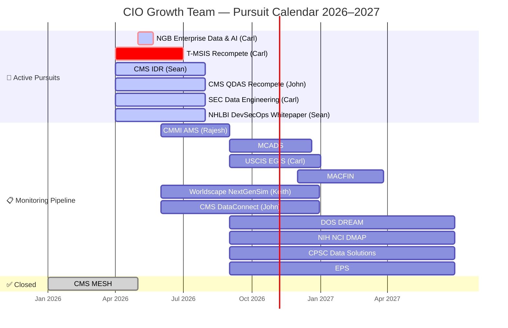

# CIO Growth Team — Pursuit Calendar Roadmap v1.0
**Program:** CIO Growth Team
**Jira Project:** CGT
**Horizon:** Q2 2026 – Q1 2027
**Audience:** Leadership
**Created:** 2026-05-19
**Delivery Model:** Kanban (continuous flow)

---

## What is this roadmap?

A pursuit calendar for the CIO Growth Team — showing which contract opportunities are actively being worked, who owns them, when key deadlines land, and what's in the monitoring pipeline.

---

## Narrative Summary

The CIO Growth Team is actively pursuing 6 contracts with 8 more in the monitoring pipeline. Dates in Jira represent **internal work completion targets**, not government RFP submission deadlines — actual government deadlines are not currently tracked in Jira (see Data Gaps).

The most immediate internal target is **NGB Enterprise Data & AI** — due May 22, confirmed on track. **T-MSIS Recompete** is the highest-stakes active pursuit with an internal deadline of July 1 and the most proposal work in flight. **CMMI AMS** is the next hard internal target at September 1.

Four active pursuits — CMS IDR, CMS QDAS, SEC Data Engineering, and NHLBI DevSecOps Whitepaper — are In Progress with no internal due dates recorded in Jira. These are invisible to planning until dates are added.

Carl Tegeder is the primary resource on 4 of 6 active pursuits simultaneously — a capacity risk worth watching.

---

## Active Pursuits (In Progress)

| Pursuit | Key | Owner | Deadline | Open Work | Risk |
|---------|-----|-------|----------|-----------|------|
| NGB Enterprise Data & AI | CGT-7 | Carl Tegeder | **May 22 🔴** | RFI Response (Done) | 2 days — is this submitted? |
| T-MSIS Recompete | CGT-2 | Carl Tegeder | Jul 1 | Storyboard, PWS, Past Perf, Orals Prep | 🔴 Most work, tightest staffed deadline |
| CMS IDR | CGT-10 | Sean Gezen | No date ⚠️ | IDR-TMS Whitepaper (Ready for Review) | No deadline in Jira |
| CMS QDAS Recompete | CGT-12 | John Fukuda | No date ⚠️ | No open stories | No work tracked, no deadline |
| SEC Data Engineering | CGT-13 | Carl Tegeder | No date ⚠️ | No open stories | No work tracked, no deadline |
| NHLBI DevSecOps Whitepaper | CGT-23 | Sean Gezen | No date ⚠️ | No open stories | No work tracked, no deadline |

---

## Monitoring Pipeline (To Do / Backlog)

| Pursuit | Key | Owner | Expected Deadline | Notes |
|---------|-----|-------|-------------------|-------|
| CMMI AMS | CGT-22 | Rajesh Pandian | Sep 1, 2026 | No stories yet |
| USCIS EGIS | CGT-15 | Carl Tegeder | Jan 1, 2027 | No stories yet |
| MCADS | CGT-20 | Unassigned | Dec 20, 2026 | Unassigned — needs owner |
| MACFIN | CGT-19 | Unassigned | Mar 27, 2027 | Unassigned — needs owner |
| Worldscape NextGenSim | CGT-9 | Keith McFarland | No date | No stories yet |
| CMS DataConnect | CGT-24 | John Fukuda | No date | Survey in To Do |
| DOS DREAM | CGT-17 | Unassigned | No date | Unassigned |
| NIH NCI DMAP | CGT-16 | Unassigned | No date | Unassigned |
| (CIV) CPSC Data Solutions | CGT-18 | Unassigned | No date | Unassigned |
| EPS | CGT-21 | Unassigned | No date | Unassigned |

---

## Timeline View

---

## Known Data Gaps

| Gap | Impact | Recommended Action |
|-----|--------|--------------------|
| Government RFP submission deadlines not tracked in Jira | Pursuit calendar shows internal work targets only — no visibility into actual government deadlines or award dates | Decide where RFP dates should live (Jira due date field, custom field, or separate tracker) and establish a process to keep them current |
| 4 active pursuits have no internal due dates (CGT-10, CGT-12, CGT-13, CGT-23) | These pursuits are invisible to planning — no way to know if work is on track | Add internal completion targets to all active pursuits |
| 5 monitoring pursuits are unassigned | No owner = no accountability when these go active | Assign owners now, before RFPs drop |

---

| # | Risk | Severity | Remedy |
|---|------|----------|--------|
| R1 | NGB deadline is May 22 — 2 days away. Confirmed on track per PM. | 🟢 Resolved | No action needed |
| R2 | Carl Tegeder is primary on 4 of 6 active pursuits simultaneously — single point of failure | 🔴 High | Redistribute at least one active pursuit; T-MSIS is highest stakes and needs dedicated focus |
| R3 | 4 active pursuits (CMS IDR, QDAS, SEC, NHLBI) have no due dates in Jira — invisible to planning | 🟡 Medium | Add due dates to CGT-10, CGT-12, CGT-13, CGT-23 this week |
| R4 | 5 monitoring pursuits are unassigned — MCADS, MACFIN, DOS DREAM, NIH NCI, CPSC | 🟡 Medium | Assign owners before these go active; unassigned work doesn't get done |
| R5 | T-MSIS has 4 open stories all assigned to Carl with a Jul 1 deadline | 🟡 Medium | Confirm whether any can be parallelized or delegated |

---

## Assumptions

| # | Assumption | Basis |
|---|-----------|-------|
| A1 | Each epic = one pursuit; In Progress = actively working, To Do/Backlog = monitoring | PM input |
| A2 | ~~Due dates on epics = proposal/RFP deadlines~~ **CORRECTED: Due dates are internal work completion targets, not government RFP deadlines** | PM input |
| A3 | Actual RFP submission deadlines are not tracked in Jira — internal dates only | PM input |
| A4 | Carl Tegeder is primary capture lead | Jira assignee data |
| A5 | CMS MESH (CGT-1) is closed — submitted or no longer pursuing | Jira status = Done |
| A6 | Monitoring pursuit end dates are estimated based on due date field; actual RFP release dates may differ | Jira data |
