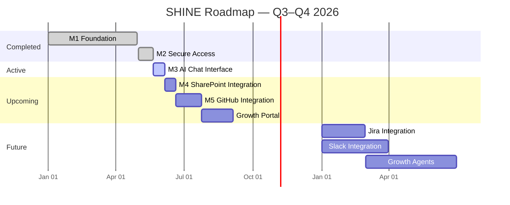

# SHINE Initiative Roadmap — v2.0
**Program:** SHINE (eSimplicity Growth Intelligence Platform)
**Jira Project:** RIC (reference only)
**Horizon:** Q3–Q4 2026
**Audience:** Leadership
**Created:** 2026-05-19
**Updated:** 2026-05-19
**Author:** PM Roadmapper
**Delivery Model:** Kanban (continuous flow)

---

## What is SHINE?

SHINE is eSimplicity's internal growth intelligence platform — a single destination where any eSimplicity employee can ask questions across internal knowledge sources and get AI-synthesized answers. For the growth team specifically, it surfaces opportunities, eventually automates RFP review and response drafting, and becomes the operating hub for capture work. Built on Databricks, accelerated by agentic AI development, validated through rigorous BDD testing.

---

## Narrative Summary

SHINE is moving fast. Authentication closes this week. The chat interface is already built and moves into BDD validation immediately after. With agentic AI handling implementation and BDD as the consistent quality gate, each integration milestone takes roughly 1–2 weeks from start to done.

By end of June, SHINE will be a live, authenticated tool where any eSimplicity employee can ask a question and get an answer synthesized from SharePoint content. GitHub follows in July, making SHINE the first place engineers go to understand code patterns and decision history. The Growth Portal — the opportunity viewer for the growth team — lands in late summer, setting the stage for growth agent capabilities in 2027.

---

## Milestone Roadmap

### M1 — Foundation ✅ Complete
**What it delivered:** A running Databricks application — the infrastructure layer that everything else is built on.

---

### M2 — Secure Access ✅ Closing This Week
**What it delivers:** Every eSimplicity employee can log in to SHINE using their existing company credentials. Access is secure, sessions are managed gracefully, and the platform is ready for real users.

**Target:** May 20–21, 2026
**Confidence:** 🟢 High

---

### M3 — AI Chat Interface 🔜 Up Next
**What it delivers:** The core SHINE experience. Users open SHINE, type a question, and get a synthesized answer. Conversation history is preserved so users can pick up where they left off. The system handles edge cases gracefully — no results, unavailable sources — without breaking the experience.

**Note:** The UI is already built. This milestone is about validating the experience end-to-end through BDD tests and ensuring it meets quality standards before users touch it.

**Target:** ~Jun 6, 2026
**Confidence:** 🟢 High

---

### M4 — SharePoint Integration
**What it delivers:** SHINE's first live knowledge source. Users can ask questions and get answers synthesized from eSimplicity's SharePoint content. Results respect SharePoint permissions — users only see what they're authorized to see. Source attribution shows where each answer came from. The system degrades gracefully if SharePoint is unavailable.

**Note:** Agentic AI handles the implementation; BDD validates the integration. Same pattern as M3.

**Target:** ~Jun 20, 2026
**Confidence:** 🟡 Medium

---

### M5 — GitHub Integration
**What it delivers:** SHINE's second knowledge source. Engineers can ask questions and get answers synthesized from eSimplicity's GitHub repositories — code patterns, design decisions, PR history, and architectural context. This replaces manual repo archaeology with synthesized, actionable guidance.

**Note:** Stories not yet written. Will be scoped during M4. Same agentic AI + BDD pattern.

**Target:** ~Late Jul 2026
**Confidence:** 🔴 Low (unscoped)

---

### Growth Portal — Opportunity Viewer
**What it delivers:** A dedicated tab in SHINE for the growth team. Members can view and track opportunities in one place without leaving the platform. Includes a report generation capability for opportunity summaries.

**Target:** ~Aug–Sep 2026
**Confidence:** 🔴 Low

---

### Future Vision (2027)
**What it delivers:** The foundation for growth agents — SHINE moves from answering questions to doing work. Planned capabilities include:
- **Jira integration** — synthesize project history, blocker patterns, and decision context
- **Slack integration** — surface capture and growth conversations
- **Admin analytics** — usage metrics and engagement data for site administrators
- **Growth agents** — automated RFP review, response drafting, opportunity qualification

---

## Timeline View

---

## Risk Register

| # | Risk | Severity | Remedy |
|---|------|----------|--------|
| R1 | Mixed capacity — SHINE throughput drops when client delivery surges | 🔴 High | Monitor weekly; escalate if pace drops for 2+ consecutive weeks |
| R2 | M5 stories not yet written — queue will run dry after M4 if not scoped in time | 🟡 Medium | Write M5 stories during M4; don't start M4 without M5 scoped |
| R3 | Growth Portal stories have no parent epic — at risk of being lost in the backlog | 🟡 Medium | Create a Growth Portal epic and link RIC-384 and RIC-381 |
| R4 | BDD rigor is the pace-setter — if test standards slip, quality debt accumulates fast | 🟡 Medium | Keep BDD as a non-negotiable gate; don't close milestones without passing tests |
| R5 | Throughput data is from mixed work types — M4/M5 are first pure-integration milestones | 🟡 Medium | Recalibrate targets after M3 closes based on actual M3 cycle time |

---

## Assumptions

| # | Assumption | Basis |
|---|---|---|
| A1 | M3 is fast because the UI is already built — work is BDD validation, not development | PM input |
| A2 | M4 and M5 follow the same agentic AI + BDD pattern — implementation is fast, testing is the gate | PM input |
| A3 | ~4 stories/week throughput observed over last 5 weeks — used as a baseline, not a hard constraint | Jira history |
| A4 | Mixed capacity team; SHINE is not 100% of anyone's time | PM input |
| A5 | Growth Portal is a parallel priority, not blocking MVP milestones | PM input |
| A6 | M5 stories will be scoped during M4 | Sequencing assumption — validate with team |
| A7 | Future integrations (Jira, Slack, growth agents) are 2027 work | Sequencing logic |
