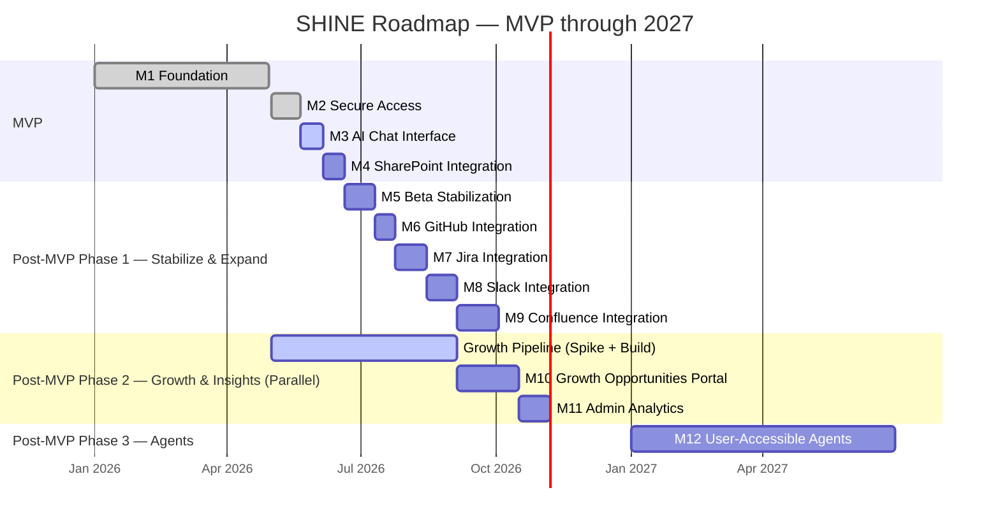

# SHINE Initiative Roadmap — v3.0
**Program:** SHINE (eSimplicity Growth Intelligence Platform)
**Jira Project:** RIC (reference only)
**Horizon:** Q3 2026 – 2027
**Audience:** Leadership
**Created:** 2026-05-19
**Updated:** 2026-05-19
**Author:** PM Roadmapper
**Delivery Model:** Kanban (continuous flow)

---

## What is SHINE?

SHINE is eSimplicity's internal growth intelligence platform — a single destination where any eSimplicity employee can ask questions across internal knowledge sources and get AI-synthesized answers. For the growth team, it surfaces opportunities, automates qualification, and eventually becomes the operating hub for capture work including RFP review and response drafting. Built on Databricks, accelerated by agentic AI development, validated through rigorous BDD testing.

---

## Narrative Summary

SHINE is organized into two phases: **MVP** and **Post-MVP**.

The MVP (Milestones 1–4) delivers the core platform — a secure, authenticated AI chat tool connected to SharePoint. This is the foundation everything else builds on. The MVP closes by end of June 2026.

Post-MVP expands SHINE into a true multi-source knowledge hub and growth intelligence platform. Phase 1 stabilizes the MVP with beta feedback and defect fixes, then adds GitHub, Jira, Slack, and Confluence as knowledge sources. Phase 2 surfaces the Growth Portal — giving the growth team a live view of incoming opportunities with agentic AI ranking. Phase 3 opens SHINE up to user-accessible agents, enabling automated workflows like RFP review and response drafting.

---

## Milestone Roadmap

---

## ── MVP ──────────────────────────────────────────

### M1 — Foundation ✅ Complete
**What it delivered:** A running Databricks application — the infrastructure layer that everything else is built on.

---

### M2 — Secure Access ✅ Closing This Week
**What it delivers:** Every eSimplicity employee can log in to SHINE using their existing company credentials. Access is secure, sessions are managed gracefully.

**Target:** May 20–21, 2026
**Confidence:** 🟢 High
**Jira:** RIC-309

---

### M3 — AI Chat Interface 🔜 Up Next
**What it delivers:** The core SHINE experience. Users open SHINE, type a question, and get a synthesized answer. Conversation history is preserved. The system handles edge cases gracefully — no results, unavailable sources.

**Note:** UI already built. This milestone is BDD validation end-to-end.

**Target:** ~Jun 6, 2026
**Confidence:** 🟢 High
**Jira:** RIC-310

---

### M4 — SharePoint Integration
**What it delivers:** SHINE's first live knowledge source. Users get answers synthesized from eSimplicity's SharePoint content. Permissions respected. Source attribution shown. Graceful degradation when unavailable.

**Target:** ~Jun 20, 2026
**Confidence:** 🟡 Medium
**Jira:** RIC-455

---

## ── POST-MVP: PHASE 1 — Stabilize & Expand ──────

### M5 — Beta Stabilization
**What it delivers:** SHINE is hardened based on real user feedback. Defects from the MVP beta are resolved. The platform is stable, performant, and ready for broader internal rollout.

**Target:** ~Jul 2026
**Confidence:** 🟡 Medium
**Jira:** RIC-490

---

### M6 — GitHub Integration
**What it delivers:** Engineers can ask questions and get answers synthesized from eSimplicity's GitHub repositories — code patterns, design decisions, PR history, and architectural context. Replaces manual repo archaeology.

**Note:** Stories not yet written. Scope during M5.

**Target:** ~Late Jul 2026
**Confidence:** 🔴 Low (unscoped)
**Jira:** RIC-456 / RIC-457

---

### M7 — Jira Integration
**What it delivers:** SHINE synthesizes knowledge from Jira — decision history, acceptance criteria evolution, blocker patterns, and scope changes. Teams can ask "why was this decision made?" and get a synthesized answer from ticket history.

**Target:** ~Aug 2026
**Confidence:** 🔴 Low
**Jira:** RIC-458

---

### M8 — Slack Integration
**What it delivers:** SHINE surfaces knowledge from Slack conversations — particularly capture and growth discussions. Institutional knowledge that lives in channels becomes searchable and synthesizable.

**Target:** ~Sep 2026
**Confidence:** 🔴 Low
**Jira:** RIC-496

---

### M9 — Confluence Integration
**What it delivers:** SHINE connects to Confluence as a knowledge source, surfacing documentation, runbooks, and decision records alongside SharePoint and GitHub content.

**Note:** No Jira epic exists yet — needs to be created.

**Target:** ~Sep–Oct 2026
**Confidence:** 🔴 Low (not yet scoped)
**Jira:** ⚠️ Epic not created

---

## ── POST-MVP: PHASE 2 — Growth & Insights ────────

### M10 — Growth Opportunities Portal
**What it delivers:** The growth team's command center inside SHINE. A dedicated tab displays all ingested opportunity postings from GovWin IQ, GSA eBuy, Seaport NxG, and FedConnect — searchable and filterable. On-demand reports summarize the opportunity pipeline for leadership. Agentic AI assigns fit ratings based on eSimplicity's past performance, capabilities, and socio-economic set-asides.

**Note:** Depends on the ingestion pipeline (RIC-283) being live. Pipeline work is running in parallel — spike (RIC-357) currently in progress with Lada.

**Target:** ~Q4 2026
**Confidence:** 🔴 Low (pipeline-dependent)
**Jira:** RIC-283, RIC-284, RIC-384, RIC-381

---

### M11 — Admin Analytics & Usage Metrics
**What it delivers:** Site administrators can see how SHINE is being used — user counts, query volume, engagement trends, and performance metrics. Provides the data needed to make informed decisions about platform investment and feature prioritization.

**Target:** ~Q4 2026
**Confidence:** 🔴 Low
**Jira:** RIC-498

---

## ── POST-MVP: PHASE 3 — Agents ───────────────────

### M12 — User-Accessible Agents
**What it delivers:** Users can invoke agents directly from SHINE to do work — not just answer questions. Initial use cases include RFP review, response drafting, and opportunity qualification. SHINE becomes an action platform, not just a knowledge platform.

**Note:** No Jira epic exists yet. Scope after Phase 2 is stable.

**Target:** 2027
**Confidence:** 🔴 Low (not yet scoped)
**Jira:** ⚠️ Epic not created

---

## Timeline View

---

## Risk Register

| # | Risk | Severity | Remedy |
|---|------|----------|--------|
| R1 | Mixed capacity — throughput drops when client delivery surges | 🔴 High | Monitor weekly; escalate if pace drops 2+ consecutive weeks |
| R2 | Growth pipeline (RIC-357 spike) has no completion date — M10 target is a placeholder | 🔴 High | Get timeline from Lada; M10 cannot be confirmed until spike resolves |
| R3 | Confluence integration has no Jira epic — will get lost without one | 🟡 Medium | Create epic before Phase 1 ends |
| R4 | M12 (Agents) has no epic and no scope — risk of indefinite deferral | 🟡 Medium | Define M12 scope during Phase 2; don't let it arrive unplanned |
| R5 | M6–M9 are sequential in the plan — if any one slips, everything behind it slips | 🟡 Medium | Assess whether M7/M8/M9 can run in parallel once M6 is underway |
| R6 | BDD is the pace-setter — if standards slip under pressure, quality debt accumulates | 🟡 Medium | Non-negotiable gate; no milestone closes without passing BDD tests |

---

## Assumptions

| # | Assumption | Basis |
|---|---|---|
| A1 | M3 is fast — UI exists, work is BDD validation not development | PM input |
| A2 | M4–M9 follow agentic AI + BDD pattern — ~1–2 weeks each | PM input |
| A3 | ~4 stories/week throughput baseline | Jira history (last 5 weeks) |
| A4 | Mixed capacity team; SHINE is not 100% of anyone's time | PM input |
| A5 | Growth pipeline track runs in parallel and is independent until M10 | Architecture |
| A6 | M10 target (~Q4 2026) assumes pipeline spike resolves by end of June | Estimate — validate with Lada |
| A7 | M6–M9 integrations are sequenced but could potentially parallelize — to be assessed | PM assumption |
| A8 | M12 (Agents) is 2027 work — scope TBD | Sequencing logic |
